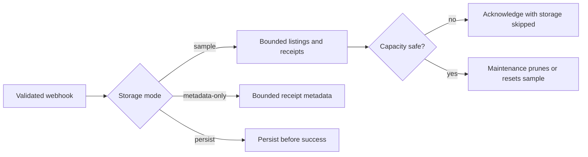

# Webhook Ingestion API (Demo)

<!-- immoteur-runtime: node=24 -->

Demo Node.js (TypeScript) webhook receiver for a bounded PostgreSQL and Metabase sample. By default, it validates a webhook and returns an acknowledgement even when the demo cannot store the request.

This repo is a companion project for:

- Immoteur: https://immoteur.com
- Full tutorial (step-by-step): https://immoteur.com/tutorials/first-bi-tool-metabase

## Requirements

- Node.js 24+
- Docker + Docker Compose
- `corepack` (bundled with Node) to run `pnpm`

## Commands (Makefile)

Run `make help` to see all targets.

## One-command local demo (wow mode)

```bash
make demo
```

This starts Postgres + API + Metabase via Docker Compose, bootstraps Metabase on first run, generates **three smee relays** (one per webhook endpoint), and prints URLs/credentials (including a **public Metabase dashboard URL** that works without logging in).

To also seed sample data:

```bash
make demo-with-seed
```

## Quickstart

For a fresh demo that stores the bounded sample, use Docker Compose:

```bash
cp .env.example .env
make stack-up
```

The API listens on `http://localhost:8080`. Compose mounts the PostgreSQL data
volume at the verified `/capacity` path used by the bounded storage checks.

### Host hot-reload workflow (development only)

For direct API development, start only PostgreSQL in Compose and run the API on
the host:

```bash
make install
make db-up
make db-migrate
make dev
```

`make dev` runs only `src/index.ts`, not the independent `src/maintenance.ts`
service. The API listens on `http://localhost:3000` (or `PORT` from `.env`), and
the default `DEMO_CAPACITY_PATH=/capacity` therefore safely acknowledges
requests with `storage: "skipped"` instead of storing a sample. To enable
guarded host-side sample writes, explicitly set `DEMO_CAPACITY_PATH` to a
verified path on the filesystem that contains the actual PostgreSQL data; do not
substitute the repository or a temporary directory.

That path enables guarded admission only; it does not provide migration
readiness, the independent cleanup/reset heartbeat, or automatic capacity
recovery. Use `make stack-up` for the complete supported lifecycle, including
migration, cleanup and reclamation, and automatic resume. Docker Desktop does
not expose a host path for its managed volume, so use the Compose stack unless
you operate PostgreSQL on a verified native data filesystem.

Before running in any shared environment, update the default credentials in
`.env` (all `CHANGE_ME` values) and avoid exposing Postgres publicly.

## Code structure

- `src/http/routes.ts`: mounts all controllers in one place
- `src/http/controllers/*`: Express routers (one file per controller)
- `src/http/mappers/*`: HTTP payload → persistence DTO mapping
- `@immoteur/openapi-zod`: OpenAPI-derived Zod schemas + TypeScript types (payload validation)
- `src/modules/webhooks/*`: webhook ingestion + `webhook_events` persistence
- `src/modules/classifieds/*`: `classifieds` mapping + persistence (incl. images + price history)
- `src/db/*`: Drizzle schema, migrations, client
- `src/maintenance.ts`: migrations, cleanup, capacity checks, and sample resets

## Docker Compose stack (API + Postgres + Metabase + smee)

This starts:

- Postgres (port `${POSTGRES_HOST_PORT:-15432}` on host)
- API (port `${API_HOST_PORT:-8080}` on host) for webhook acknowledgements
- Maintenance for migrations, cleanup, capacity checks, and guarded sample resets
- Metabase (port `${METABASE_HOST_PORT:-3001}` on host)
- Optional smee relays (forwards smee.io → API inside the Compose network)

```bash
cp .env.example .env
make stack-up

# Optional: enable the 3 smee relays
node scripts/smee-ensure.mjs
make stack-up-smee
```

Defaults:

- smee targets (inside Compose network):
  - classified-notification → `http://api:3000/webhooks/classified-notification`
  - classified-notification-batch → `http://api:3000/webhooks/classified-notification-batch`
  - classifieds-export → `http://api:3000/webhooks/classifieds-export`
- API: `http://localhost:8080`
- Metabase UI: `http://localhost:3001`
- Maintenance diagnostics: `http://127.0.0.1:${MAINTENANCE_HOST_PORT:-8081}`

Troubleshooting:

- If `db-bootstrap` exits with code `2`, it couldn’t connect to Postgres (most often: credentials don’t match an existing Docker volume). For a clean demo reset: `make stack-reset-smee` (wipes volumes).
- If you change `scripts/metabase-bootstrap.mjs` and don’t see dashboard updates, re-run the one-shot bootstrap container: `make metabase-rebootstrap` (or reset volumes for a full clean run).

## Choose a storage mode

`DEMO_STORAGE_MODE` controls storage for single notifications, batches, and
exports. It defaults to `sample`, which is the recommended mode for a public
demo.

> [!IMPORTANT]
> **0.2.0 compatibility change:** `sample` is now the default, replacing the
> previous persistence-first behavior. An existing installation that depends on
> durable local data must set `DEMO_STORAGE_MODE=persist` before upgrading.

| Mode            | Request result                                                                | Data retained                                                                                                                              |
| --------------- | ----------------------------------------------------------------------------- | ------------------------------------------------------------------------------------------------------------------------------------------ |
| `sample`        | Acknowledges the request, including when bounded storage is unavailable.      | A bounded recent sample of listings and receipt metadata.                                                                                  |
| `metadata-only` | Acknowledges the request, including when receipt storage is unavailable.      | Bounded receipt metadata only.                                                                                                             |
| `persist`       | Returns `503` when the database is unavailable before its receipt is written. | Uses the legacy durable receipt and listing flow; the legacy export setting can limit export payloads during the compatibility transition. |

In `sample` and `metadata-only` modes, a successful response includes a
`storage` field. Its value is `sampled`, `metadata-only`, or `skipped`; a
`skipped` result includes a reason such as `initializing`, `unavailable`,
`capacity`, `rate-limit`, `contention`, or `item-limit`.

Those responses also include `storedItems`. It can be `0` even for an
acknowledgement: metadata-only receipts do not materialize listings, and sample
mode skips an oversized or otherwise ineligible listing whole rather than
truncating it.

An acknowledgement confirms that the receiver handled the request. It does not
guarantee that the demo retained a receipt or listing when `storage` is
`skipped`.

### Bounded sample lifecycle



Sample mode retains at most 1,000 listings from the previous 24 hours and at
most 1,000 receipt rows from the previous 12 hours. It stores no raw webhook
JSON and caps stored diagnostic text, so the dashboard is a recent sample rather
than a durable delivery archive.

The maintenance process checks capacity every five seconds and runs cleanup at
least once a minute. At the default 8 GiB database budget or 20 GiB free-space
reserve, sample and metadata-only writes stop; they resume only after the
database is below its budget and, after the reserve is tripped, the free-space
probe has more than 24 GiB available.

In sample mode, capacity pressure can reset the disposable ingestion dataset:
`webhook_events`, `classifieds`, `classified_images`, and
`classified_price_history`. The reset does not touch Metabase configuration,
but it permanently removes the sample data and does not guarantee that a
database file will shrink immediately.

`persist` is an explicit opt-in for installations that need durable local data.
It returns an error when its capacity check or receipt write fails, and it does
not run the automatic sample reset.

### Configure capacity

The supplied `.env.example` uses safe defaults:

| Variable                  | Default       | Purpose                                                                        |
| ------------------------- | ------------- | ------------------------------------------------------------------------------ |
| `DEMO_STORAGE_MODE`       | `sample`      | Chooses bounded sampling, metadata-only receipts, or explicit persistence.     |
| `DEMO_DATABASE_MAX_BYTES` | `8589934592`  | Stops sample writes when the PostgreSQL database reaches 8 GiB.                |
| `DEMO_MIN_FREE_BYTES`     | `21474836480` | Stops sample writes when the capacity filesystem has 20 GiB or less available. |
| `DEMO_CAPACITY_PATH`      | `/capacity`   | Compose-only mount of the filesystem checked for available space.              |

Docker Compose mounts the PostgreSQL volume read-only at `/capacity` for the
API and maintenance services. The `.env.example` value is therefore valid only
inside those services. For a non-Compose deployment, set
`DEMO_CAPACITY_PATH` to a verified path on the same filesystem as PostgreSQL
data; a project directory, a temporary directory, or an inferred Docker Desktop
volume path is not a substitute.

`CLASSIFIEDS_EXPORT_STORAGE_MODE` is deprecated. It is read only when
`DEMO_STORAGE_MODE=persist` to preserve the previous export-specific behavior;
set `DEMO_STORAGE_MODE` explicitly instead. When the legacy variable is set,
the service logs a deprecation warning.

### Maintenance and migration readiness

Compose starts a separate `maintenance` service from the same image after
`db-bootstrap` completes. It applies migrations and runs cleanup while the API
continues to serve acknowledgements. In the default disposable Compose stack,
its `MAINTENANCE_PORT` is mapped only to
`127.0.0.1:${MAINTENANCE_HOST_PORT:-8081}` for local soak tests and diagnostics;
that loopback-only mapping is inherited by the public Caddy Compose overlay.

## Production (VPS) with Caddy (TLS)

This repo includes a simple Caddy reverse-proxy setup (`docker-compose.caddy.yml` + `docker/caddy/Caddyfile`) to expose only Caddy's `80/443` ports publicly and keep direct Postgres, Metabase, and API ports unexposed.

1. Create DNS records pointing to your VPS:
   - `API_DOMAIN` (e.g. `api.demo.example.com`)
   - `METABASE_DOMAIN` (e.g. `metabase.demo.example.com`)
2. Create `.env` from `.env.example` and set at least:
   - `POSTGRES_PASSWORD`, `API_DB_PASSWORD`, `METABASE_READER_PASSWORD`, `METABASE_ADMIN_PASSWORD`
   - `ACME_EMAIL`, `API_DOMAIN`, `METABASE_DOMAIN`
   - Optional: `WEBHOOK_ALLOWED_IP` to enable the API's `/webhooks/*` IP allowlist
   - Set `DEMO_STORAGE_MODE` explicitly after choosing the contract in [Choose a storage mode](#choose-a-storage-mode).
   - Optional: change the capacity values only after measuring the PostgreSQL data filesystem and confirming that the new reserve still protects the host.
3. Start the production stack:

```bash
docker compose -f docker-compose.yml -f docker-compose.caddy.yml up -d --build
```

URLs:

- API: `https://$API_DOMAIN`
- Metabase: `https://$METABASE_DOMAIN`

Notes:

- In production mode, the API enables Express `trust proxy` (1 hop). Caddy overwrites `X-Forwarded-For`/`X-Real-IP` so client IPs can’t be spoofed.
- Optional: set `METABASE_PUBLIC_DASHBOARD_UUID` to enable a stable pretty URL `https://$METABASE_DOMAIN/demo` → `https://$METABASE_DOMAIN/public/dashboard/<uuid>`.
- Caddy blocks `/ready` and `/metrics` from its public routes, including case
  and trailing-slash variants. The loopback maintenance mapping remains
  available for local diagnostics.

## Webhook endpoints

This service exposes these webhook endpoints:

| Immoteur delivery mode | Canonical route                                 | Retained direct route                    |
| ---------------------- | ----------------------------------------------- | ---------------------------------------- |
| Single notifications   | `POST /webhooks/classified-notification-single` | `POST /webhooks/classified-notification` |
| Batch notifications    | `POST /webhooks/classified-notification-batch`  | —                                        |
| Exports                | `POST /webhooks/classified-export`              | `POST /webhooks/classifieds-export`      |

The single-notification and export routes JSON-parse and validate payloads with OpenAPI-derived `Zod.safeParse`. Successful responses use the storage contract above, so `200` means the receiver handled the request but may not mean the demo retained it.

The batch route returns `400` for an invalid header or body without creating a receipt. The demo intentionally does **not** persist raw request bodies or headers.

### Batch notifications

`POST /webhooks/classified-notification-batch` accepts only a strict `{ "items": [...] }` body with one to ten complete `Classified` snapshots whose IDs are distinct. It also requires a non-empty `User-Agent`, UUID `X-Immoteur-Service-Id`, `X-Immoteur-Event-Id`, and `X-Immoteur-Delivery-Id` headers, plus a numeric Unix `X-Immoteur-Timestamp` header.

The batch route returns `400` for invalid headers or body. In `sample` and
`metadata-only` modes, a valid batch returns `200` with its storage outcome;
in `persist` mode, a storage failure returns `503`.

The classified row and its images and price history update together only when the incoming (`meta.lastModifiedAt`, `meta.lastSeenAt`) pair is strictly newer. An equal pair keeps the first stored snapshot, an older pair is a no-op, and receipt time does not decide which source snapshot wins.

### IP allowlist

Set `WEBHOOK_ALLOWED_IP` to allow requests to `/webhooks/*` from specific source
addresses. Use a comma-separated list of exact IPv4 or IPv6 addresses and CIDR
blocks, for example `203.0.113.10,2001:db8::/32`.

Whitespace around entries is ignored. Every entry must be valid; an empty entry
or invalid address prevents the API from starting and reports a
`WEBHOOK_ALLOWED_IP` configuration error. Leave the variable unset or blank to
disable the filter for a standalone deployment.

The allowlist does not apply to `/health`. A webhook request from an unlisted
source receives `403` with `{ "ok": false }`.

### Example request

```bash
curl -sS -X POST "http://localhost:8080/webhooks/classified-notification" \
  -H "content-type: application/json" \
  -d '{"id":"7f6e3b4d-9c22-46a0-8f20-0d1a2b3c4d5e","type":"created"}'
```

To send a realistic payload from this repo:

```bash
curl -sS -X POST "http://localhost:8080/webhooks/classified-notification" \
  -H "content-type: application/json" \
  -d @demo/payloads/classified-notification.example.json

curl -sS -X POST "http://localhost:8080/webhooks/classifieds-export" \
  -H "content-type: application/json" \
  -d @demo/payloads/classifieds-export.example.json
```

If you’re running the API directly (no Docker), use `http://localhost:3000` instead of `:8080`.

## Migrations (Drizzle Kit)

- Edit schema: `src/db/schema.ts`
- Generate migration: `make db-generate NAME=create_table_...` (or omit `NAME` for Drizzle defaults)
- Apply migrations: `make db-migrate`

`make db-migrate` applies the migration journal to a local development database.
Docker Compose assigns migration readiness to the internal maintenance service,
so the webhook API can acknowledge valid sample-mode requests while PostgreSQL
is restarting.

Migrations live in `src/db/migrations/`.

## OpenAPI schemas/types

This demo validates webhook payloads using `@immoteur/openapi-zod` (Zod schemas + TypeScript types generated from the Immoteur OpenAPI spec).

To update schemas/types, bump `@immoteur/openapi-zod` in `package.json` and reinstall.

## Adding a new webhook handler

This demo is intentionally limited to classifieds webhooks:

- `classified-notification-single` (with the retained `classified-notification` route)
- `classified-notification-batch`
- `classified-export` (with the retained `classifieds-export` route)

To add another webhook:

1. Ensure `@immoteur/openapi-zod` contains the payload schema for the new webhook (update/publish it if needed), then bump the dependency in this repo.
2. Create a controller in `src/http/controllers/` (e.g. `webhooks.<name>.controller.ts`) using the imported schema + `ingestWebhook`.
3. Register it in `src/http/routes.ts`.
4. Add/update tests in `tests/webhooks.test.ts`.

## Security

Please report vulnerabilities privately. See `SECURITY.md`.

## Contributing

See `CONTRIBUTING.md` and `CODE_OF_CONDUCT.md`.

## License

MIT. See `LICENSE`.

## Metabase

Metabase should connect directly to Postgres using a read-only user.

### Connection info (local)

- Host: `localhost`
- Port: `15432`
- Database: `webhooks_ingest`
- User: `metabase_reader` (create below)

Metabase can query:

- `webhook_events` (bounded ingestion receipts; sample and metadata-only modes keep no raw payload JSON)
- `classifieds` (a bounded recent sample of flattened `Classified` listing snapshots)
- `classified_images` (one row per image, FK to `classifieds`)
- `classified_price_history` (one row per price change, FK to `classifieds`)

### Read-only user SQL

When using Docker Compose, the `metabase_reader` role is created automatically **on first Postgres init** using:

- `METABASE_READER_USER` (default: `metabase_reader`)
- `METABASE_READER_PASSWORD` (default: `CHANGE_ME`)

The API uses a separate Postgres role (created automatically on first init):

- `API_DB_USER` (default: `api_writer`)
- `API_DB_PASSWORD`

If you run Postgres outside Compose, run as a superuser (e.g. `postgres`):

```sql
create user metabase_reader with password 'CHANGE_ME';

grant connect on database webhooks_ingest to metabase_reader;
grant usage on schema public to metabase_reader;

grant select on all tables in schema public to metabase_reader;
alter default privileges in schema public grant select on tables to metabase_reader;

grant select on all sequences in schema public to metabase_reader;
alter default privileges in schema public grant select on sequences to metabase_reader;
```
